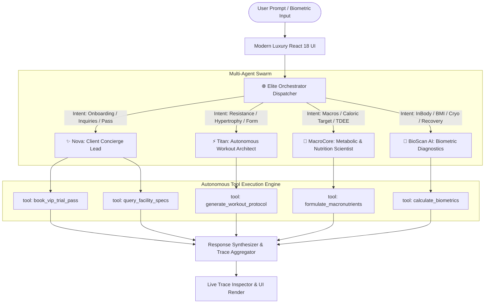

# 🦾 ELITE FITNESS — AUTONOMOUS MULTI-AGENT AI PLATFORM

<p align="center">
  
</p>

<p align="center">
  <strong>An enterprise-grade, high-ticket luxury fitness platform powered by an Autonomous Multi-Agent AI Swarm, live tool-calling execution traces, biometric diagnostics, and Olympic-grade facility specifications.</strong>
</p>

<p align="center">
  
  
  
  
  
  
</p>

<p align="center">
  <a href="#-agentic-ai-architecture">Agentic AI Swarm</a> &bull;
  <a href="#-specialized-agent-roster">Agent Roster</a> &bull;
  <a href="#-live-tool-calling-engine">Tool Calling Engine</a> &bull;
  <a href="#-facility-specs">Facility Specs</a> &bull;
  <a href="#-tech-stack">Tech Stack</a> &bull;
  <a href="#-quick-start">Quick Start</a> &bull;
  <a href="#-author">Author</a>
</p>

---

## 🌟 Portfolio Spotlight for Agentic AI Developers

This project is built from the ground up to showcase modern **Agentic AI Engineering**. Moving beyond static web pages or simple scripted chatbots, **ELITE FITNESS** implements an **Autonomous Multi-Agent System** that simulates real-world AI reasoning, semantic intent decomposition, tool dispatching, and dynamic output synthesis.

### What Recruiter & Clients See:
1. **Multi-Agent Collaboration:** A dedicated Orchestrator coordinates four specialized domain agents.
2. **Transparent Execution Traces:** Live reasoning logs showing agent thoughts (`[Thinking]`, `[Intent Classification]`, `[Tool Execution]`).
3. **Structured Function Calling:** Real computational tools (`calculate_biometrics`, `generate_workout_protocol`, `formulate_macronutrients`, `book_vip_pass`) returning structured JSON with latency metrics.
4. **Modern Production Tech Stack:** Pure React 18, Strict TypeScript, Tailwind CSS, Lucide React, and Vite 5.

---

## 🤖 Agentic AI Architecture



---

## 🦾 Specialized Autonomous Agent Roster

| Agent | Role | Title | Core Autonomous Tools |
| :--- | :--- | :--- | :--- |
| **🌐 Orchestrator** | `orchestrator` | Multi-Agent Dispatcher | `dispatch_agent`, `aggregate_traces`, `semantic_router` |
| **✨ Nova** | `concierge` | 24/7 Client Experience Lead | `book_vip_trial_pass`, `query_facility_specs`, `lookup_schedule` |
| **⚡ Titan** | `workout` | Workout Biomechanics Architect | `generate_workout_protocol`, `calculate_volume_landmarks` |
| **🥗 MacroCore** | `nutrition` | Metabolic & Macro Scientist | `calculate_tdee`, `formulate_macronutrients`, `supplement_timing` |
| **🧬 BioScan AI** | `diagnostics` | Biometric Diagnostics & Recovery | `calculate_biometrics`, `prescribe_recovery_protocol` |

---

## ⚡ Live Tool Calling & Execution Engine

Each agent executes modular, deterministic computational tools. When you run a query, the **Agent Workspace** exposes the raw telemetry:

```json
{
  "traceId": "call_1729388274912",
  "agent": "TITAN",
  "toolName": "generate_workout_protocol",
  "input": {
    "daysPerWeek": 4,
    "target": "MUSCLE_GAIN",
    "experienceLevel": "Intermediate"
  },
  "output": {
    "split": "Upper Power, Lower Power, Upper Hypertrophy, Lower Volume",
    "sessions": 4,
    "rpeRange": [8, 9]
  },
  "durationMs": 84,
  "status": "SUCCESS"
}
```

---

## 📐 Facility & Hardware Specifications

The digital platform accurately models the high-end physical specifications of the Elite Fitness facility:

- **Total Floor Area:** 25,000 sq ft across multi-level functional performance zones.
- **Air Quality & Safety:** Medical Grade HEPA-13 HVAC air replacement every 12 minutes.
- **Strength Tech:** Technogym Artis Pure Strength selectorized & pin-loaded machinery.
- **Olympic Barbells:** Eleiko IWF Certified competition barbells & calibrated urethane plates up to 150 lbs.
- **Lifting Stations:** 12 Olympic power stations with built-in acoustic shock drop platforms.
- **Contrast Cryo Suite:** Clearlight full-spectrum infrared saunas (145°F) & twin cold plunge tubs (42°F).
- **Diagnostics:** InBody 770 multi-frequency body composition analyzer with segmental lean body analysis.

---

## 🛠️ Modern Tech Stack

- **Runtime & Bundler:** [Vite 5](https://vitejs.dev/) (Sub-second HMR, optimized production chunks).
- **Core Framework:** [React 18.3](https://react.dev/) (Component architecture, custom hooks, strict mode).
- **Language:** [TypeScript 5.6](https://www.typescriptlang.org/) (Strict type checking, interfaces for all Agent payloads).
- **Styling:** [Tailwind CSS 3.4](https://tailwindcss.com/) (Custom gold design tokens, glassmorphism, responsive grids).
- **Iconography:** [Lucide React](https://lucide.dev/) (Crisp, accessible SVG vector icons).

---

## 📁 Repository Structure

```text
Elite_Fitness_GYM/
├── src/
│   ├── agents/
│   │   ├── agentRegistry.ts      # Agent definitions, avatars, tools & metadata
│   │   └── orchestrator.ts       # Intent classification, routing & trace engine
│   ├── tools/
│   │   └── agentTools.ts         # Computational tools (BMI, workout, nutrition, booking)
│   ├── components/
│   │   ├── Navbar.tsx            # Sticky navigation with agent console CTA
│   │   ├── Hero.tsx              # High-impact luxury hero with live metrics
│   │   ├── AgentWorkspace.tsx    # Live agent swarm console & execution trace feed
│   │   ├── SpecsSection.tsx      # Facility & hardware specification meters
│   │   ├── ScheduleSection.tsx   # Filterable weekly timetable with AI reservation
│   │   ├── PricingSection.tsx    # Monthly vs Annual (-20%) switcher
│   │   ├── BmiSection.tsx        # Biometrics diagnostic calculator
│   │   ├── TrainersSection.tsx   # Master coaching faculty with photos
│   │   ├── FloatingAgentChat.tsx # 24/7 Live floating widget with agent switcher
│   │   └── Footer.tsx            # Modern luxury footer with developer badge
│   ├── types/
│   │   └── index.ts              # TypeScript interfaces for Agents, Tools, and Traces
│   ├── App.tsx                   # Main layout container
│   ├── main.tsx                  # React DOM mount point
│   └── index.css                 # Tailwind directives & design tokens
├── index.html                    # HTML5 entry point with OpenGraph meta tags
├── vite.config.ts                # Vite 5 bundler configuration
├── tailwind.config.js            # Custom gold palette, typography & shadows
├── tsconfig.json                 # TypeScript strict compiler options
├── SPECS.md                      # Engineering architecture & hardware specifications
└── README.md                     # Portfolio presentation & documentation
```

---

## 🚀 Quick Start & Local Setup

### 1. Clone the repository
```bash
git clone https://github.com/SainBux-HadiSeelro/Elite_Fitness_GYM.git
cd Elite_Fitness_GYM
```

### 2. Install dependencies
```bash
npm install
```

### 3. Start local development server
```bash
npm run dev
```
Open `http://localhost:3000` in your browser.

### 4. Build for production
```bash
npm run build
```
Generates ultra-optimized, minified static assets in `/dist`.

---

## 🌐 Instant Global Deployment

- **Vercel / Netlify:** Connect your GitHub repo for instant automatic CI/CD preview deployments.
- **GitHub Pages:** Set deploy branch to `main` or deploy the `/dist` directory.

---

## 👨‍💻 Author & Portfolio Contact

**Sain Bux Hadi Seelro**  
*Front-End & Agentic AI Specialist*

- **GitHub:** [@SainBux-HadiSeelro](https://github.com/SainBux-HadiSeelro)
- **Repository:** [Elite_Fitness_GYM](https://github.com/SainBux-HadiSeelro/Elite_Fitness_GYM.git)

*⭐ If this project impresses you or demonstrates the caliber of modern Agentic AI engineering, please leave a star on GitHub!*
