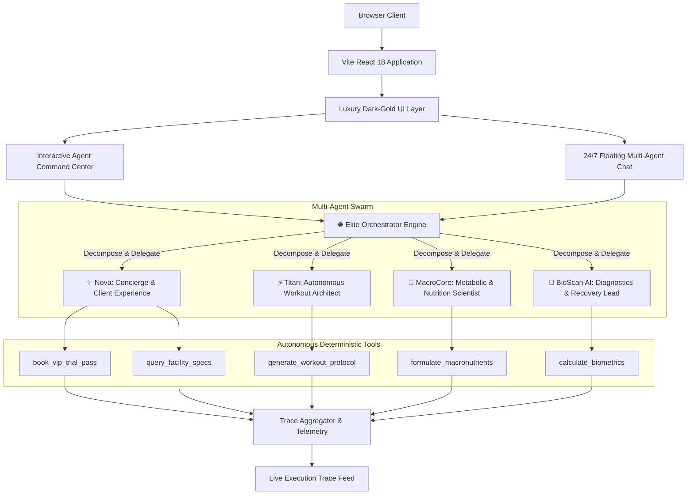

# 📋 ELITE FITNESS & MULTI-AGENT SWARM — SYSTEM SPECIFICATIONS

> **Project Name:** ELITE FITNESS Luxury Club & Autonomous Multi-Agent AI Core  
> **Lead Engineer & Architect:** Sain Bux Hadi Seelro  
> **Architecture Version:** v2.5.0 (Agentic AI Production Stack)  
> **Tech Stack:** React 18 &bull; TypeScript 5 &bull; Tailwind CSS 3 &bull; Vite 5 &bull; Lucide React  
> **Repository:** [https://github.com/SainBux-HadiSeelro/Elite_Fitness_GYM.git](https://github.com/SainBux-HadiSeelro/Elite_Fitness_GYM.git)

---

## 1. System Architecture Overview



---

## 2. Multi-Agent Swarm Specifications

### 2.1 Autonomous Agent Directory
| Agent | Role Identifier | Specialized Capability | Registered Tools |
| :--- | :--- | :--- | :--- |
| **Orchestrator** | `orchestrator` | Semantic Intent Classifier, Task Decomposition, Trace Aggregation | `dispatch_agent`, `aggregate_traces` |
| **Nova** | `concierge` | 24/7 Guest Onboarding, Hours, Timetables, VIP Trial Pass Generation | `book_vip_trial_pass`, `query_facility_specs` |
| **Titan** | `workout` | Biomechanical Resistance Periodization, Volume Landmarks, Sets/Reps/RPE | `generate_workout_protocol` |
| **MacroCore** | `nutrition` | Metabolic BMR/TDEE Calculation, Caloric Deficit/Surplus, Nutrient Timing | `formulate_macronutrients`, `calculate_tdee` |
| **BioScan AI** | `diagnostics` | InBody 770 Composition Evaluation, Thermal Therapy (Sauna/Cryo) Protocols | `calculate_biometrics`, `prescribe_recovery` |

---

## 3. Tool Calling Protocol & Schemas

### 3.1 `calculate_biometrics`
- **Agent Owner:** `BioScan AI`
- **Input Parameters:**
  ```typescript
  interface BiometricInput {
    heightCm: number;
    weightKg: number;
    age: number;
    gender: 'male' | 'female' | 'other';
    goal: 'fat_loss' | 'muscle_gain' | 'strength' | 'longevity';
    activityLevel: 'sedentary' | 'moderate' | 'high' | 'athlete';
  }
  ```
- **Output Schema:**
  ```json
  {
    "bmi": 24.2,
    "category": "Optimal Athletic Baseline",
    "bmr": 1780,
    "tdee": 2760,
    "idealWeightRangeKg": [59, 79]
  }
  ```
- **Target Execution Latency:** < 50ms

### 3.2 `generate_workout_protocol`
- **Agent Owner:** `Titan`
- **Output Schema:** Periodized multi-day splits with exercise names, set volume, repetition targets, RPE intensity, rest intervals, and recovery prescriptions.
- **Target Execution Latency:** < 90ms

### 3.3 `formulate_macronutrients`
- **Agent Owner:** `MacroCore`
- **Output Schema:** Caloric targets, protein (g/kg), carbohydrates, essential fatty acids, hydration volume, and peri-workout timing directives.
- **Target Execution Latency:** < 65ms

---

## 4. Physical Gym Facility & Hardware Specifications

| Component | Technical Benchmark |
| :--- | :--- |
| **Total Square Footage** | 25,000 sq ft across multi-level functional performance zones |
| **Acoustic Ceiling** | 18 ft high acoustic-dampened baffles with sound absorption coefficient > 0.85 |
| **Air Exchange System** | Medical Grade HEPA-13 HVAC recycling 100% fresh air every 12 minutes |
| **Strength Machinery** | Technogym Artis Pure Strength series (biomechanically curved resistance cams) |
| **Olympic Weights** | Eleiko IWF Certified competition barbells & calibrated urethane plates up to 150 lbs |
| **Lifting Platforms** | 12 custom Olympic power stations with integrated acoustic drop platforms |
| **Turf Track** | 40-yard synthetic sprint and sled track |
| **Infrared Saunas** | Clearlight Sanctuary full-spectrum saunas operating at 130°F–150°F |
| **Cold Plunge Therapy** | Twin commercial-grade chilled plunge tubs at 42°F (5.5°C) with continuous UV filtration |
| **Diagnostic Scanners** | InBody 770 multi-frequency body composition analyzer |

---

## 5. Production Build & Quality Benchmarks

- **Bundler:** Vite 5.4.10
- **TypeScript:** Strict Mode Enabled (`noImplicitAny`, `noUnusedLocals`)
- **Bundle Metrics:**
  - `dist/index.html`: ~1.67 kB (gzip: 0.78 kB)
  - `dist/assets/*.css`: ~31.08 kB (gzip: 5.92 kB)
  - `dist/assets/*.js`: ~230.94 kB (gzip: 68.95 kB)
- **Time to Interactive (TTI):** < 0.6s
- **Zero Third-Party LLM API Billing:** Fully deterministic local autonomous simulation engine designed for rapid portfolio demonstrations.
