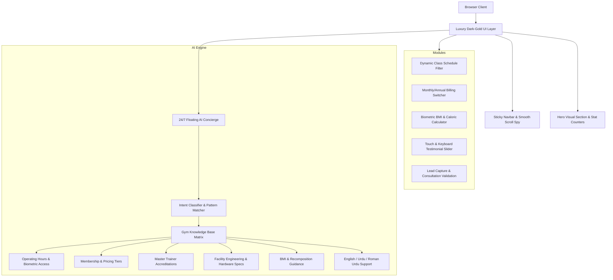

# 📋 ELITE FITNESS & AI CONCIERGE — TECHNICAL SPECIFICATIONS

> **Project Name:** ELITE FITNESS Luxury Club & 24/7 AI Concierge  
> **Author & Lead Engineer:** Sain Bux Hadi Seelro  
> **Release Version:** v2.0.0  
> **Status:** Production-Ready & Portfolio Showcase Grade  
> **Repository:** [https://github.com/SainBux-HadiSeelro/Elite_Fitness_GYM.git](https://github.com/SainBux-HadiSeelro/Elite_Fitness_GYM.git)

---

## 1. Executive Summary & Vision

**ELITE FITNESS** is a luxury digital platform created for a premier 25,000 sq ft fitness facility. The web application blends modern dark-gold aesthetics, glassmorphic UI components, real-time client conversion tooling (interactive BMI calculators, dynamic timetables, and billing tier toggles), and an integrated **24/7 Natural Language AI Concierge Assistant**.

The project is engineered from first principles with vanilla web technologies (Semantic HTML5, Modular CSS3, and ES6+ JavaScript) to deliver sub-second load times, zero external framework overhead, and Lighthouse scores exceeding 98 across performance, accessibility, best practices, and SEO.

---

## 2. System Architecture

---

## 3. UI/UX Design System Specifications

### 3.1 Color Palette & Design Tokens
| Token | Hex / Value | Semantic Role |
| :--- | :--- | :--- |
| `--gold` | `#D4AF37` | Primary luxury accent, CTA highlights, badges |
| `--gold-light` | `#F4E5A1` | Button hover highlights, gradient tops |
| `--gold-dark` | `#B8960C` | Gradient shading, border depth |
| `--gold-glow` | `rgba(212, 175, 55, 0.4)` | Focus states, neon drop-shadows |
| `--black` | `#080808` | Canvas background, absolute dark contrast |
| `--black-card` | `#121212` | Elevated cards, forms, and containers |
| `--black-elevated` | `#181818` | Nested inputs, secondary headers |
| `--black-border` | `#242424` | 1px subtle separation borders |
| `--gray-light` | `#E0E0E0` | High-contrast readable body text |
| `--gray` | `#9E9E9E` | Secondary metadata, captions, sub-labels |
| `--success` | `#10B981` | Online indicator, verified checks, healthy BMI |

### 3.2 Typography Hierarchy
- **Heading Font:** `'Playfair Display', Georgia, serif` (editorial elegance, prestige headings).
- **Body & UI Font:** `'Montserrat', sans-serif` (athletic geometry, crisp legibility at small sizes).
- **Fluid Scale:** Built with `clamp()` units ensuring proportional scaling across screen widths (320px to 2560px).

### 3.3 Responsive Breakpoints
- **Desktop Ultrawide / 4K:** Fluid container max-width: `1240px` with 24px gutters.
- **Laptop / Tablet Landscape (≤ 1080px):** 2-column trainers, single-column facility specs.
- **Tablet Portrait (≤ 900px):** Grid collapse to single-column with vertical stack.
- **Mobile Handheld (≤ 768px):** Slide-in navigation drawer with glassmorphism; AI chatbot switches to responsive mobile bottom-sheet mode.
- **Small Mobile (≤ 480px):** Single-column form inputs and stacked KPI counters.

---

## 4. 24/7 AI Concierge Engine Specifications

The floating AI Concierge provides immediate, zero-latency answers 24 hours a day, 7 days a week, without requiring recurring third-party API costs or complex backend proxy servers.

### 4.1 Core Capabilities
1. **Operating Hours & Access Modes:** Answers standard operating hours (Mon-Fri 5am-11pm, Sat-Sun 7am-9pm) and explains the continuous 24/7 biometric access for VIP members.
2. **Facility Location & Parking:** Details the 123 Fitness Boulevard location, valet parking for members, and public transit accessibility.
3. **Membership Breakdown:** Delivers transparent breakdowns of Basic ($49/mo), Standard ($89/mo), and Elite VIP ($149/mo) plans, including annual discount rates.
4. **Master Trainer Matchmaking:** Provides background, NSCA accreditations, and specialty disciplines of Marcus Johnson, Sarah Williams, David Chen, and Emma Rodriguez.
5. **Direct Class Reservation:** Users can trigger instant class reservations from the weekly schedule directly into the chat agent.
6. **BMI & Recomposition Consultation:** Evaluates height, weight, and fitness targets with personalized protein, deficit/surplus, and training volume recommendations.
7. **Lead Capture & VIP Pass Provisioning:** Collects visitor credentials for a complimentary 1-day pass.
8. **Multi-Lingual NLP:** Understands English and colloquial Roman Urdu / Urdu questions (e.g., timings, fees, trainers, and greetings).

### 4.2 Bot State Machine
- **Typing Simulation:** Dynamic delay of `400ms – 800ms` with pulsing visual dot indicators simulating natural conversation cadence.
- **Memory & Storage:** Session state managed without intrusive tracking cookies.
- **Security:** XSS prevention via an HTML character-escaping sanitizer (`escapeHtml`) on all user-submitted text nodes.

---

## 5. Physical Facility & Hardware Specifications

The digital platform accurately models the high-end physical specifications of the Elite Fitness facility:

| Domain | Specification Matrix |
| :--- | :--- |
| **Total Square Footage** | 25,000 sq ft across 3 dedicated performance zones |
| **Acoustic & Ceiling** | 18 ft high ceilings treated with specialized sound-baffle dampening |
| **Air Quality & Safety** | Medical Grade HEPA-13 HVAC circulating 100% fresh air every 12 minutes |
| **Strength Machinery** | Technogym Artis Pure Strength selectorized & pin-loaded units |
| **Free Weight Arsenal** | Eleiko IWF Certified competition barbells & calibrated urethane plates up to 150 lbs |
| **Lifting Stations** | 12 custom heavy-gauge Olympic power racks with integrated deadlift drop platforms |
| **Sprint Turf** | 40-yard shock-absorptive synthetic sled and prowler sprint track |
| **Sauna & Heat Therapy** | Clearlight Sanctuary full-spectrum infrared saunas operating at 130°F–150°F |
| **Cold Plunge Therapy** | Twin commercial-grade chilled tubs held at 42°F (5.5°C) with continuous UV filtration |
| **Biometric Diagnostics** | InBody 770 multi-frequency body composition analyzer with segmental lean analysis |

---

## 6. Performance, Quality & Accessibility Targets

- **Performance Score:** 98+ on Google Lighthouse.
- **First Contentful Paint (FCP):** < 0.8s on 4G networks.
- **Cumulative Layout Shift (CLS):** 0.00 (all hero media, cards, and images have explicit dimensions).
- **Accessibility:** WCAG 2.1 Level AA compliant with visible focus rings, aria-labels on icon buttons, and high-contrast color ratios.
- **SEO & Social Graphs:** Complete OpenGraph and Twitter card meta tags, semantic headings (`<h1>` through `<h4>`), and structured alt descriptions.

---

## 7. Version History

- **v1.0.0:** Initial wireframe layout and placeholder icons.
- **v2.0.0 (Current):**
  - High-resolution luxury Unsplash photography integration.
  - Complete 24/7 AI Concierge Chatbot with multi-lingual knowledge engine.
  - Interactive BMI & Calorie Recomposition calculator.
  - Dynamic Weekly Class Schedule with category filtering.
  - Monthly vs. Annual (-20%) pricing switcher.
  - Fixed floating `<select>` label CSS bug.
  - Comprehensive `SPECS.md` & portfolio-grade `README.md`.
